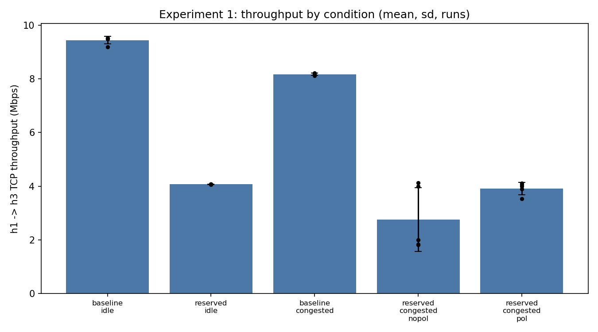
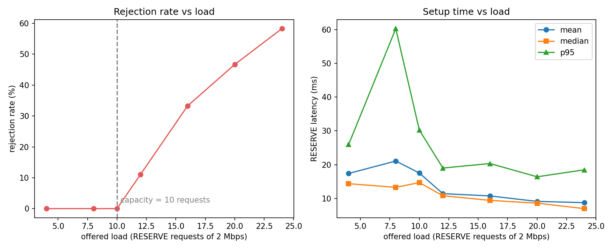
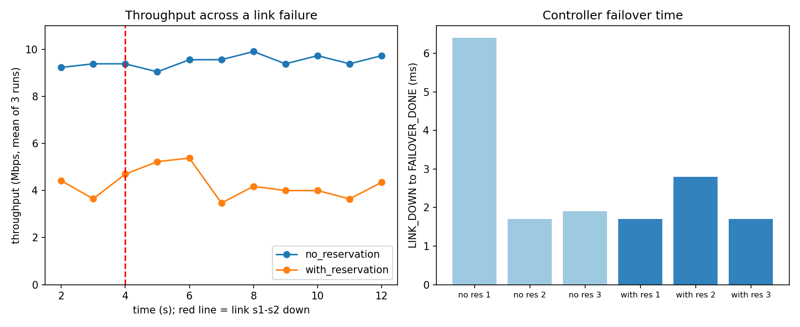
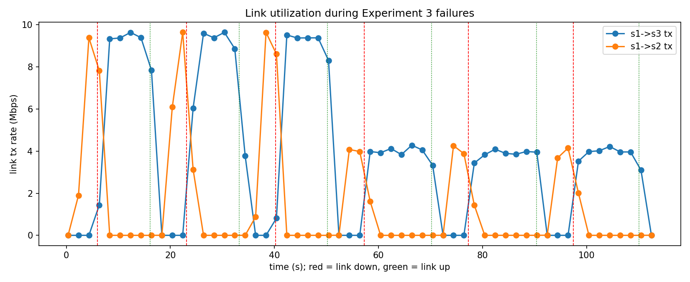

# Network Resource Reservation System (SDN + TCP Sockets)

Jackfruit mini project (SDN-Socket Programming). Users request bandwidth over a TCP service; a Ryu OpenFlow 1.3 controller validates each request (admission control) and installs flows and meters in a Mininet network.

## 1. How it works

1. A client (h1 or h2) opens a TCP connection to the reservation server on `hs` (port 9000) and authenticates.
2. The client sends `RESERVE <src> <dst> <bw_mbps> <duration_s> <priority>`.
3. The server calls the Ryu REST API (port 8080). The controller checks the 10 Mbps cap of each link on the primary path, then the backup path, otherwise it rejects with `insufficient_bandwidth`.
4. If admitted, the controller installs priority-100 flows and a meter (the reserved rate) on the switches of the chosen path.
5. Every 2 s the controller polls port statistics (utilization log). A link failure is detected via `OFPPortStatus` and reservations are rerouted to the backup path.
6. Optional best-effort policing throttles ordinary traffic so reserved flows are protected under congestion.

## 2. Architecture

~~~
client (h1/h2) --TCP 9000--> res_server.py (hs) --REST 8080--> Ryu controller
Ryu controller --OpenFlow 1.3 (port 6633)--> s1, s2, s3, s4
h1,h2 -- s1 ==( s2 primary | s3 backup )== s4 -- h3, hs
~~~

`hs` reaches the controller through a management veth link (192.168.100.2 -> 192.168.100.1).

## 3. Topology

| Link | Bandwidth |
|---|---|
| h1-s1, h2-s1 | 50 Mbps |
| s1-s2, s1-s3, s2-s4, s3-s4 | 10 Mbps |
| s4-h3, s4-hs | 50 Mbps |

Hosts: h1 = 10.0.0.1, h2 = 10.0.0.2, h3 = 10.0.0.3 (iperf receiver), hs = 10.0.0.4 (reservation server).
Primary path s1-s2-s4, backup path s1-s3-s4.

## 4. Application protocol (TCP port 9000, one text line per message)

| Command | Meaning |
|---|---|
| `AUTH <user> <token>` | log in (users: alice/pass1, bob/pass2, admin/adminpw) |
| `RESERVE <src> <dst> <bw_mbps> <duration_s> <priority 0-7>` | request bandwidth between two hosts |
| `RELEASE <id>` | free a reservation (only the owner or admin) |
| `STATUS` | list reservations |

Replies are `OK <id>`, `REJECT <reason>` or `ERR <msg>`. Reasons seen in testing: `bad_credentials`, `not_authenticated`, `insufficient_bandwidth`, `not_owner`, `usage`, `out_of_range`.

## 5. How to run

Start in this order. Never run `sudo mn -c` while Ryu is running.

**Terminal A** (controller):

~~~
cd /home/vboxuser/sdn-reservation
sudo mn -c          # only BEFORE starting Ryu
source ~/ryu-env/bin/activate
ryu-manager controller/reservation_ctrl.py
~~~

**Terminal B** (topology; the management link and TCP server start automatically):

~~~
cd /home/vboxuser/sdn-reservation
sudo python3 topo/topo.py
~~~

**Terminal B, at the `mininet>` prompt** (example client request from h1):

~~~
h1 python3 /home/vboxuser/sdn-reservation/client/res_client.py 10.0.0.4 alice pass1 "RESERVE 10.0.0.1 10.0.0.3 4 300 3"
~~~

**Terminal C** (normal terminal): curl, git and ovs-ofctl. Check the controller with `curl -s http://127.0.0.1:8080/status`.

## 6. Functional tests (Blocks 1-5)

| Test | Result |
|---|---|
| pingall | 0% dropped (12/12) |
| iperf h3 -> h1, no reservation | 9.34 Mbps |
| 4 Mbps reservation h1 -> h3 | 4.21 Mbps (meter enforced); 9.52 Mbps after release |
| Admission control | 4+4 Mbps on primary, 3rd 4 Mbps moved to backup, 7 Mbps rejected (`insufficient_bandwidth`); `/links` showed 8.0/8.0 primary, 4.0/4.0 backup |
| Invalid and unauthorized requests | `bad_credentials`, `not_authenticated`, `ERR usage`, `ERR out_of_range` (bw 15, priority 9), `REJECT not_owner` |
| Request latency | AUTH about 1 ms, RESERVE through Ryu 4-21 ms |
| Monitoring | s1->s2 utilization 9.4-9.6 Mbps during iperf, 0.0 idle |

## 7. Performance evaluation

### Experiment 1: throughput of a reserved flow (h1 -> h3, 4 Mbps reservation)

5 runs of 20 s iperf per condition. Congestion = h2 sends 4 parallel TCP streams to h3, starting 2 s after h1's flow.

| Condition | Mean (Mbps) | Runs (Mbps) |
|---|---|---|
| baseline_idle (no reservation) | 9.44 | 9.48 / 9.19 / 9.52 / 9.48 / 9.52 |
| reserved_idle | 4.07 | see results/exp1_throughput.csv |
| baseline_congested | 8.17 (see note) | 8.22 / 8.12 / 8.15 / 8.17 / 8.19 |
| reserved_congested, policing OFF | 2.75 | 3.99 / 1.99 / 1.82 / 4.12 / 1.84 |
| reserved_congested, policing ON | 3.92 | 4.06 / 3.53 / 3.99 / 3.89 / 4.11 |

Result: with best-effort policing ON the reserved flow stays close to its 4 Mbps (mean 3.92); with policing OFF it drops to a mean of 2.75 with runs as low as 1.82.

**Note on baseline_congested.** The saved CSV shows about 8.2 Mbps. Repeating the same scenario by hand gave 3.29 Mbps and 0.18 Mbps (with several 0-Mbps seconds), and an earlier run gave 0.10 Mbps. We could not explain the difference. TCP competition from four streams on a shared 10 Mbps link is chaotic, so the average of an unreserved flow is unstable between executions (0.1 to 8.2 Mbps), while the policing-ON runs stay within 3.5-4.1 Mbps. We report both values instead of choosing one.

### Experiment 2: load and admission control

Each client (h1 as alice, h2 as bob) sends RESERVE requests of 2 Mbps over real TCP through the SDN network, 3 repetitions per load level, reservations released between runs. Capacity is 10 requests (5 per path).

| Load | Sent | Admitted | Rejected | Reject % | Latency mean / median / p95 (ms) |
|---|---|---|---|---|---|
| 4 | 12 | 12 | 0 | 0.0% | 17.40 / 14.36 / 26.00 |
| 8 | 24 | 24 | 0 | 0.0% | 21.08 / 13.28 / 60.30 |
| 10 | 30 | 30 | 0 | 0.0% | 17.53 / 14.69 / 30.25 |
| 12 | 36 | 32 | 4 | 11.1% | 11.42 / 10.81 / 19.00 |
| 16 | 48 | 32 | 16 | 33.3% | 10.74 / 9.42 / 20.34 |
| 20 | 60 | 32 | 28 | 46.7% | 9.12 / 8.60 / 16.41 |
| 24 | 72 | 30 | 42 | 58.3% | 8.75 / 6.98 / 18.47 |

Overall mean TCP connect 6.46 ms, AUTH 3.74 ms, RELEASE 13.16 ms. There are no rejections up to load 10, then the rejection rate rises. Latency falls as load rises because rejected requests are answered faster (no path computation or flow install). Some runs admitted 11-12 instead of 10 because each client releases its reservations right after its own RESERVE loop, freeing capacity while the other client is still reserving (test-design overlap, not an admission-control bug).

### Experiment 3: link failure and failover

h1 -> h3 iperf for 12 s; link s1-s2 taken down at +4 s; 3 repetitions per case, policing off. The first iperf second is excluded (socket-buffer artifact). Throughput values are means in Mbps.

| Case | Before | Min after | Zero seconds | Recovered | LINK_DOWN to FAILOVER_DONE |
|---|---|---|---|---|---|
| no reservation | 9.33 | 9.04 | 0 | 9.62 | 6.4 / 1.7 / 1.9 ms |
| 4 Mbps reservation | 4.25 | 3.29 | 0 | 4.03 | 1.7 / 2.8 / 1.7 ms |

The reservation moved to the backup path [1,3,4] (REROUTED) in 0.3-0.4 ms. Without a reservation only the default routes switch, so there is no REROUTED event. iperf has 1 s resolution, so outages under about 1 s are only visible in the controller timestamps.

## 8. Known limitations

- Meters only cap rates. Best-effort policing is not work-conserving: best-effort traffic stays throttled even while the reserved flow is idle (queues would be work-conserving but clash with Mininet's tc shaping).
- Reservations are kept in memory and are lost when Ryu restarts.
- Sources must be on s1 (h1, h2) and destinations on s4 (h3, hs); the controller has static knowledge of the topology.
- Reservation IDs on the server are the controller's IDs.
- The TCP server serializes controller calls with a lock, which adds latency under concurrent load.
- iperf has 1 s resolution, so sub-second outages are only visible in the controller timestamps.
- Experiment 2 admitted counts above 10 come from clients releasing while the other is still reserving.
- Experiment 1 baseline_congested is unstable between executions (see the note in section 7).

## 9. Files

| File | Purpose |
|---|---|
| `topo/topo.py` | diamond topology, management link, starts the TCP server |
| `controller/reservation_ctrl.py` | Ryu app: routing, admission control, meters, REST API, monitoring, failover, policing |
| `controller/base_ctrl.py` | Block 1 static routes (unused) |
| `server/res_server.py` | multithreaded TCP reservation server |
| `client/res_client.py` | command-line client |
| `tests/exp1_throughput.py` | Experiment 1 (throughput) |
| `tests/res_load_worker.py`, `tests/exp2_load.py` | Experiment 2 (load) |
| `tests/exp3_failover.py` | Experiment 3 (failover) |
| `tests/plots.py` | makes the plots from the CSVs |
| `results/` | CSV results, plots, controller logs |
| `results/block5/` | saved Block 5 evidence |
| `scripts/setup_mgmt.sh` | old manual veth helper (obsolete) |
